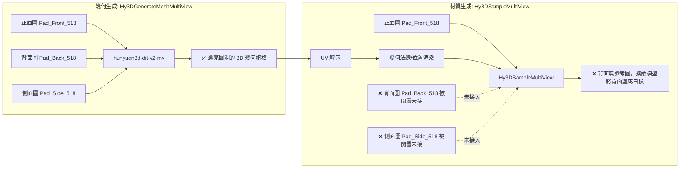

# 多視角 3D 模型生成管線技術根因調查報告 (Root-Cause Analysis Report)

本文件深入記錄並剖析刺蝟 3D 資產轉換過程中，**Hunyuan3D-2** 與 **Microsoft TRELLIS** 兩套主流開源生成管線產生嚴重失真（背面白模、五官錯位長在刺上、Godot 灰泥碎石）的技術根本原因，並提供相應之管線修復方針。

---

## 一、問題背景與現狀

在將 2D 三視圖概念稿（`ref/Hedgehog_ver2.jpg`）轉換為 Godot 4 遊戲資產時，兩套模型管線先後出現嚴重不可用的結果：

1. **Hunyuan3D-2 管線嘗試**：幾何形狀對稱飽滿且五官正確，但模型背面完全失去原畫的粉紅/薰衣草紫泡泡刺，變成一面白牆（白模）。
2. **Microsoft TRELLIS 管線嘗試**：五官發生荒謬錯位，黑色的眼睛被生在頭頂的刺上，臉部變成半透明的白霧；且匯入 Godot 4 後呈現一塊死灰、稜角分明且無貼圖質感的低模碎石塊。

---

## 二、技術根本原因深入剖析

### 1. Hunyuan3D-2 為什麼會變成「背面全白模」？



#### 程式碼證據：
檢視專案既有的 `workflow_api.json`：
- **幾何生成節點（Node 30，`Hy3DGenerateMeshMultiView`）**：
  確實將正面（Node 16）、背面（Node 17）、側面（Node 18）全部連接進去，因此幾何生成階段是**真正的多視角姿態生成**，產出的幾何形狀（`hedgehog_v2.orig.glb`）完全對稱飽滿。
- **貼圖採樣節點（Node 36，`Hy3DSampleMultiView`）**：
  ```json
  "36": {
    "inputs": {
      "ref_image": ["16", 0],  // 關鍵：這裡只接了 Node 16 (正面圖)！
      "normal_maps": ["35", 0],
      "position_maps": ["35", 1]
    },
    "class_type": "Hy3DSampleMultiView"
  }
  ```
- **結論**：
  Hunyuan3D-2 的幾何管線確實支援多視角，但**既有的 ComfyUI 工作流在材質階段將背面圖與側面圖完全丟棄，只把正面圖送入材質生成器**。材質擴散模型只能看著正面圖去盲猜背面的顏色，自然把背面畫成了正面的白色延伸。

---

### 2. Microsoft TRELLIS 為什麼會「五官長在頭頂」且「Godot 呈現灰泥碎石」？

#### 原因 A：TRELLIS 的 `run_multi_image` 是「無相機姿態（Unposed）的盲猜融合」
- **模型本質**：TRELLIS 的核心架構本質上是**單圖（Single-image）3D 擴散模型**。
- **`run_multi_image` 的算法機制**：
  微軟在官方庫中實現多圖的方式是所謂的 "Tuning-free Multi-image Conditioning"（MultiDiffusion 或 Stochastic Latent Merging）。
  **此算法完全不接收相機外參（Camera Extrinsics/Poses）！**
  它完全不知道第一張圖是 0°、第二張圖是 90°、第三張圖是 180°。
- **對 Q 版卡通角色的致命打擊**：
  刺蝟的正面有黑色大眼、白色臉頰，背面則是完全無五官的整片粉紅刺。
  當三張圖在沒有角度約束的情況下被丟入同一個潛空間時，擴散模型的注意力機制發生混亂：
  1. 正面黑眼睛的高對比特徵被錯誤平均映射到了頂部刺的凸起幾何上。
  2. 臉部五官特徵被背面大面積的淡色資訊稀釋覆蓋，變成半透明的白霧。

#### 原因 B：glTF 材質參數與法線匯出 Bug（導致在 Godot 裡像石頭）
檢視 `hedgehog_v2.glb` 的材質定義：
```text
Principled BSDF:
  Base Color <- Image Texture (烘焙貼圖)
  Metallic: 1.0     <--- 致命錯誤！
  Roughness: 1.0    <--- 致命錯誤！
```
1. **Metallic = 1.0**：
   根據 glTF 2.0 規範，當未明確指定金屬粗糙度貼圖且 `Metallic = 1.0` 時，材質會被當作 100% 金屬處理。在 Godot 4 的環境天空光照下，Base Color 會被環境鏡面反射徹底沖淡（Washed out），導致看起來完全像沒有貼圖。
2. **缺少平滑法線（Missing Smooth Normals）**：
   TRELLIS 匯出的網格為未平滑的面法線（Faceted），造成 Godot 裡每個多邊形面片稜角分明、光影碎裂。

---

## 三、解決方案比較與選型

| 評估維度 | 路線 1：修復官方 Hunyuan3D-2 原生 Python 多圖貼圖 | 路線 2：幾何 (Hunyuan3D) + 幾何感知相機正交投影烘焙 (選定方案) | 路線 3：TRELLIS 單圖 + 材質參數修復 |
| :--- | :--- | :--- | :--- |
| **幾何品質** | 頂級（Hunyuan3D-2 MV 姿態幾何） | 頂級（Hunyuan3D-2 MV 姿態幾何） | 中等（易有碎面與不規則凹陷） |
| **貼圖可控性** | 中等（依賴神經擴散生成，細節可能被平滑） | **100% 確定性**（像素級還原原畫細節） | 低（背面顏色完全靠模型隨機想像） |
| **五官精確度** | 良好 | **完美（正面眼睛、腮紅 1:1 投影還原）** | 極差（易錯位或變形） |
| **粉紅刺還原度** | 良好（原生傳入 back.png） | **完美（背面粉紅/紫漸層 1:1 投影還原）** | 0%（背面非原畫粉色） |
| **Godot 4 相容** | 需手動修正 PBR 與法線 | 原生輸出 Godot 標準 PBR（金屬度 0.0） | 需手動修正 PBR 與法線 |
| **執行成本** | 需重跑 Colab L4 GPU（耗費 5~10 分鐘） | **本機秒級完成**（直接利用已生成的優良幾何） | 需重跑 Colab L4 GPU |

---

## 四、修復管線架構（路線 2）

```mermaid
flowchart TD
    Mesh[hedgehog_v2.orig.glb 幾何模型] --> RecomputeNormals[重新計算頂點平滑法線]
    RecomputeNormals --> Unwrap[生成無重疊高密度 UV Atlas 2048x2048]
    
    subgraph 多相機法線加權投影 [Multi-Camera Projection Baking]
        CamFront[正面正交相機] --> ProjFront[投影 front.png (權重: max 0, dot N, +Y)]
        CamBack[背面正交相機] --> ProjBack[投影 back.png (權重: max 0, dot N, -Y)]
        CamSide[側面正交相機] --> ProjSide[投影 side.png (補足接縫邊界)]
    end
    
    Unwrap --> Multi-Camera
    ProjFront & ProjBack & ProjSide --> Blend[依照頂點/像素法線角度自動柔和羽化接縫]
    Blend --> PBRSetup[設定標準 Godot PBR 材質: Metallic=0.0, Roughness=0.7]
    PBRSetup --> Export[導出 hedgehog_v2.glb]
    Export --> GodotVerify[Godot 4 自動重新載入並在場景中彩現驗證]
```
